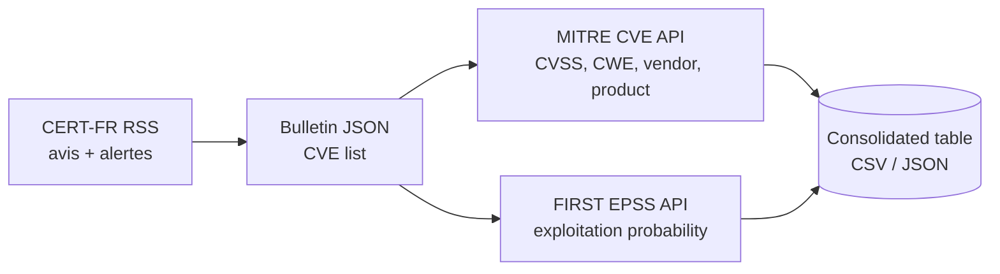

# ANSSI Security Bulletins × CVE Enrichment

[](https://github.com/srn8r/Analyse_Avis_Alertes_ANSSI_Enrichissement_CVE/actions/workflows/ci.yml)


A small data pipeline that collects the security **advisories** and **alerts** published by
[CERT-FR](https://www.cert.ssi.gouv.fr/) (ANSSI, the French national cybersecurity agency),
extracts every CVE they reference and enriches it with **MITRE** and **FIRST EPSS** data.
The result is one consolidated table, ready for triage, a dashboard or a database.

## Why

A CERT-FR bulletin says *what* is affected, but not how severe each CVE is or how likely it
is to be exploited. This tool joins the three sources so you can answer questions such as
"which CVEs published this week are critical **and** likely to be exploited?" in one filter.

## Pipeline



1. **Feeds**: read the CERT-FR RSS feeds for advisories and alerts.
2. **Bulletins**: fetch the JSON version of each bulletin to get its ANSSI ID and CVE list.
3. **MITRE**: fetch each unique CVE record once (CVSS v4.0 → v3.1 → v3.0 → v2.0, falling back
   to ADP containers such as CISA Vulnrichment when the CNA gives no score).
4. **EPSS**: fetch exploitation probabilities in batches of 100 CVEs per request.
5. **Output**: one row per bulletin / CVE pair, sorted by date, written to CSV or JSON.

Requests run in parallel, with timeouts and automatic retries on rate limiting (HTTP 429)
and server errors. A failing bulletin or CVE is logged and skipped instead of stopping the run.

## Quick start

```bash
git clone https://github.com/srn8r/Analyse_Avis_Alertes_ANSSI_Enrichissement_CVE.git
cd Analyse_Avis_Alertes_ANSSI_Enrichissement_CVE
python -m venv .venv && source .venv/bin/activate   # Windows: .venv\Scripts\activate
pip install -e .

anssi-cve                                   # all feeds -> output/anssi_cve.csv
```

### Options

```bash
anssi-cve --feeds alerte                    # alerts only
anssi-cve --limit 5                         # 5 bulletins per feed, for a quick test
anssi-cve --min-cvss 9 -o critical.json     # critical CVEs only, as JSON
anssi-cve --help
```

### From Python or a notebook

```python
from anssi_cve.http import build_session
from anssi_cve.pipeline import run

df = run(build_session(), limit=10)
df[(df["CVSS"] >= 9) & (df["EPSS"] >= 0.1)]
```

## Output columns

Column names are kept in French, as in the CERT-FR source data.

| Column | Source | Notes |
|---|---|---|
| ID ANSSI, Titre ANSSI, Type, Date, Lien | CERT-FR feed | `Type` is `Avis` or `Alerte` |
| CVE | Bulletin JSON | empty if the bulletin lists no CVE |
| CVSS, Base Severity | MITRE | severity computed from the score if not provided |
| CWE, Description | MITRE | English description |
| Éditeur, Produit, Versions affectées | MITRE | all affected products, comma-separated |
| EPSS | FIRST | probability of exploitation in the next 30 days (0 to 1) |

## Project structure

```
src/anssi_cve/
├── cli.py        command-line interface
├── config.py     data sources and output schema
├── http.py       shared session (timeouts, retries)
├── feeds.py      CERT-FR feeds and bulletins
├── mitre.py      CVE record parsing
├── epss.py       EPSS scores (batched)
├── severity.py   CVSS qualitative rating
└── pipeline.py   orchestration and DataFrame
tests/            offline tests, every API call is mocked
```

## Development

```bash
pip install -e ".[dev]"
pytest          # runs offline
ruff check . && ruff format .
```

GitHub Actions runs lint and tests on Python 3.10 and 3.12 for every push and pull request.

## Roadmap

- [x] CSV / JSON export
- [x] Base Severity from the CVSS score
- [ ] Email alerts for critical vulnerabilities
- [ ] Scheduled runs for continuous monitoring
- [ ] Dashboard (vendors, products, CVSS, EPSS)
- [ ] Storage in a SQL database

## Data sources

- [CERT-FR advisories](https://www.cert.ssi.gouv.fr/avis/) and [alerts](https://www.cert.ssi.gouv.fr/alerte/)
- [CVE Services API](https://cveawg.mitre.org/api/) (MITRE / CVE Program)
- [EPSS API](https://www.first.org/epss/api) (FIRST)

## Contributors

[srn8r](https://github.com/srn8r) · [kuresad](https://github.com/kuresad)
